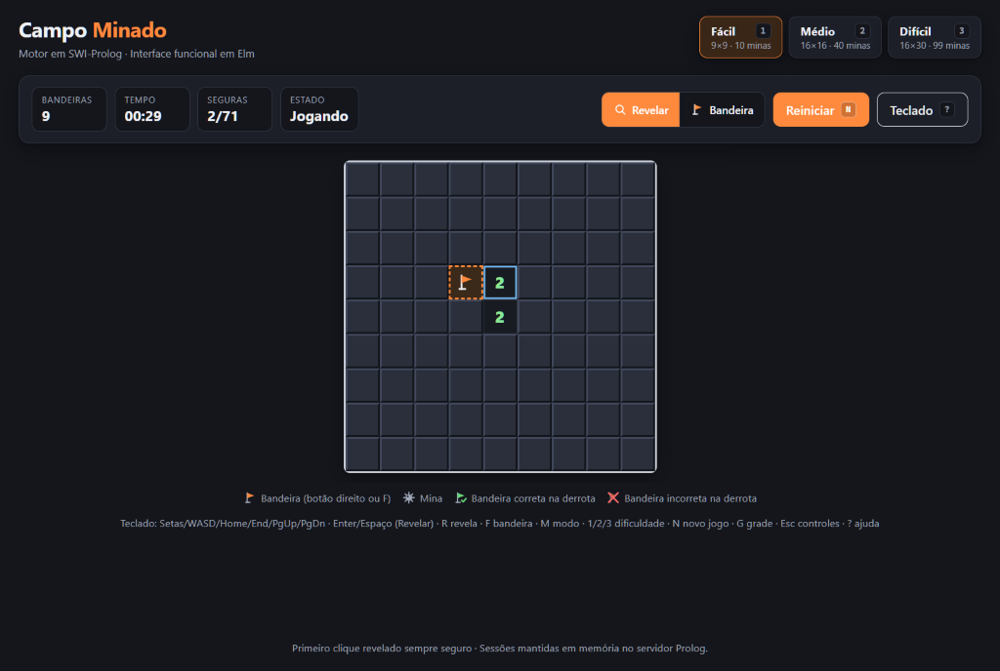

# Campo Minado — Prolog + Elm

## 1. Identificação

| Nome completo | Matrícula | Turma (14h/16h) | Usuário GitHub |
|---------------|-----------|-----------------|----------------|
| Gustavo Xavier Evangelista | 241025247 | 14h | @guxvr |
| Rodrigo Henrique Donato de Souza | 000000000 | 14h | @Fofodoido |
| Davi Araujo Bady Casseb | 211031682 | 14h | @CK753 |
| Mateus de Siqueira Silva | 200024787 | 14h | @siqueira-prog |
| Carlos Eduardo Mendes de Mesquita | 190085584 | 14h | @CarlosEduardoMendesdeMesquita |
| Gabriel Basto Bertolazi | 202023663 | 14h | @Bertolazi |

- **Nome do projeto:** Campo Minado — Prolog + Elm
- **Nome do grupo:** SuperSMs
- **Repositório:** https://github.com/Fofodoido/Super_Sudoku_Minesweeper
- **Commit ou tag entregue:** `8e45ca9`
- **Ponto de partida:** outro jogo conhecido
- **Slides da apresentação oral:** não há

## 2. Resumo

O projeto implementa uma aplicação web completa de Campo Minado (*Minesweeper*) com três níveis de dificuldade (`easy` 9×9 com 10 minas, `medium` 16×16 com 40 minas e `hard` 16×30 com 99 minas), combinando backend declarativo em SWI-Prolog e frontend funcional puro em Elm. O Prolog é a única fonte de verdade das regras do domínio: modela a geometria da grade, sorteia as minas de forma preguiçosa garantindo que a primeira revelação seja sempre segura, executa a expansão em largura (*flood-fill* BFS) de regiões com zero minas adjacentes, valida transições de estado (`ready`, `playing`, `won`, `lost`) e projeta snapshots públicos que jamais vazam minas ocultas ao cliente durante a partida. O frontend em Elm consome a API HTTP/JSON v1 (`/api/games`), coordena a sincronização resiliente a falhas de rede e oferece uma interface responsiva com navegação completa por teclado e acessibilidade WAI-ARIA.



## 3. Como executar

**Requisitos** (com as versões que o grupo usou):

- SWI-Prolog 10.0.2 (compatível com 9.1.12 ou superior)
- Node.js 22.x e Elm 0.19.1 / 0.19.2
- uv e Python 3.12 (para o script validador de entrega)

**Instalação e execução:**

```sh
make build
make run
```

**Testes:**

```sh
make test
make validar
```

**Testado em:** Linux (Ubuntu 24.04 via WSL2 no Windows 11), navegadores Chromium e Firefox em `http://localhost:8080`.

## 4. Arquitetura

```
[Elm (Main / Board / Game / Api)] --HTTP/JSON (/api/games)--> [SWI-Prolog HTTP (server.pl)] --> [Sessões (sessions.pl)] --> [Motor e Geometria (game.pl / board.pl)]
```

| Parte | Responsabilidade | Arquivos principais |
|-------|------------------|---------------------|
| Prolog (Domínio e Motor) | Geometria do tabuleiro, geração segura de minas na primeira revelação, expansão BFS, transições de estado e projeção pública sem vazamento de minas | `backend/minesweeper/board.pl`, `backend/minesweeper/game.pl` |
| Prolog (Sessões e HTTP) | Armazenamento concorrente de partidas em memória com mutexes particionados, expiração por TTL e endpoints REST JSON v1 | `backend/minesweeper/sessions.pl`, `backend/server.pl` |
| Elm (Modelo e Cliente HTTP) | Modelagem algébrica do domínio público, encoders/decoders JSON com validação de invariantes e coordenação do ciclo de requisição/recuperação | `frontend/src/Game.elm`, `frontend/src/Api.elm`, `frontend/src/Main.elm` |
| Elm (Interface e Acessibilidade) | Renderização do tabuleiro, HUD, navegação por teclado com *roving tabindex*, atributos WAI-ARIA e animação SVG de explosão | `frontend/src/Board.elm`, `frontend/src/Explosion.elm`, `frontend/public/style.css` |

## 5. Parte em Prolog

### 5.1 Predicados principais

| Predicado | Local | O que faz |
|-----------|-------|-----------|
| `preset(?Difficulty, ?Rows, ?Cols, ?MineCount)` | `backend/minesweeper/board.pl:24` | Define declarativamente as dimensões e total de minas de cada dificuldade (`easy`, `medium`, `hard`). |
| `neighbors(+Rows, +Cols, +Cell, -Neighbors)` | `backend/minesweeper/board.pl:51` | Calcula as células vizinhas válidas em 8 direções sem extrapolação de bordas e sem incluir a própria célula. |
| `generate_mines(+Rows, +Cols, +MineCount, +SafeCell, -Mines)` | `backend/minesweeper/board.pl:65` | Sorteia `MineCount` posições únicas excluindo `SafeCell` e devolve o conjunto ordenado de minas. |
| `adjacent_mines(+Rows, +Cols, +Mines, +Cell, -Count)` | `backend/minesweeper/board.pl:78` | Conta quantas células vizinhas de `Cell` pertencem ao conjunto de minas `Mines`. |
| `new_game(+Difficulty, -Game)` | `backend/minesweeper/game.pl:37` | Inicializa o termo opaco `game_state/10` no estado `ready`, revisão `0` e minas ainda não geradas (`ungenerated`). |
| `game_action(+Game0, +Action, -Result)` | `backend/minesweeper/game.pl:90` | Valida e executa `reveal` ou `toggle_flag` (aceitando termos Prolog ou dicts JSON), devolvendo `ok(Game)` ou `error(Reason)`. |
| `expand_safe(+Queue, +Rows, +Cols, +Mines, +Flagged, +Revealed0, -Revealed)` | `backend/minesweeper/game.pl:177` | Executa busca em largura (BFS) com `ordsets` para revelar automaticamente componentes conexas de células com zero minas adjacentes e sua borda numérica. |
| `public_snapshot(+Id, +Game, -Snapshot)` | `backend/minesweeper/game.pl:251` | Constrói o dicionário público serializável para JSON, ocultando minas e contagens não reveladas enquanto a partida está ativa. |
| `apply_session_action(+Id, +Action, -Result)` | `backend/minesweeper/sessions.pl:81` | Serializa a leitura, transição e atualização da sessão sob um mutex particionado por hash do UUID. |
| `dispatch_games(+Method, +Segments, +Request)` | `backend/server.pl:67` | Roteia `POST /api/games`, `GET /api/games/:id` e `POST /api/games/:id/actions` mapeando erros de domínio para códigos HTTP 400, 404, 405, 409 e 503. |

### 5.2 Conceitos do paradigma lógico utilizados

- [x] Fatos e regras como base de conhecimento: `backend/minesweeper/board.pl:24-26` (`preset/4`) e `backend/minesweeper/game.pl:135-136` (`game_ended/1`).
- [x] Unificação e casamento de padrões: desconstrução do termo opaco `game_state/10` e normalização de ações em `backend/minesweeper/game.pl:98-133` e `backend/minesweeper/game.pl:206-233`.
- [x] Recursão (inclusive sobre listas): fila de expansão em largura `expand_safe/7` em `backend/minesweeper/game.pl:177-188`.
- [x] Backtracking e múltiplas soluções: geração de coordenadas e vizinhanças via `between/3` em `backend/minesweeper/board.pl:46-60` e busca de sessão única com `repeat` em `backend/minesweeper/sessions.pl:180-184`.
- [x] `findall/3`, `bagof/3`, `setof/3` ou similares: enumeração da grade e vizinhos em `backend/minesweeper/board.pl:46-60` e coleta de sessões com `findall/3` e `aggregate_all/3` em `backend/minesweeper/sessions.pl:48` e `backend/minesweeper/sessions.pl:212`.
- [x] Corte (`!`) ou negação (`\+`), e por que foram necessários: compromissos determinísticos após validação de guarda em `backend/minesweeper/game.pl:93`, `backend/minesweeper/game.pl:173` e `backend/minesweeper/game.pl:210` (evitando *choicepoints* residuais e vazamento de cláusulas de fim de jogo) e `\+ game_session(Id, _, _)` em `backend/minesweeper/sessions.pl:183`.
- [ ] Programação por restrições (CLP(FD) ou outra): não utilizada no domínio do Campo Minado (os módulos legados de Sudoku que a usavam foram retirados no PR #13).
- [x] Predicados de ordem superior (`maplist`, `foldl`, `include` e `exclude`): `maplist/2`, `include/3` e `exclude/3` em `backend/minesweeper/board.pl:81-84` e `backend/minesweeper/game.pl:182-204`.
- [x] Outro: conjuntos ordenados (`library(ordsets)`) para invariantes de células reveladas, bandeiras e minas em `backend/minesweeper/game.pl:140-186`, e concorrência declarativa com `with_mutex/2` em `backend/minesweeper/sessions.pl:63-135`.

### 5.3 Trecho em destaque

```prolog
expand_safe([], _, _, _, _, Revealed, Revealed) :- !.
expand_safe([Curr|Rest], Rows, Cols, Mines, Flagged, Revealed0, Revealed) :-
    adjacent_mines(Rows, Cols, Mines, Curr, Count),
    (   Count =:= 0
    ->  neighbors(Rows, Cols, Curr, Neighbors),
        exclude(cell_blocked(Mines, Flagged, Revealed0), Neighbors, ToVisit),
        sort(ToVisit, NewCells),
        ord_union(Revealed0, NewCells, Revealed1),
        append(Rest, NewCells, NextQueue),
        expand_safe(NextQueue, Rows, Cols, Mines, Flagged, Revealed1, Revealed)
    ;   expand_safe(Rest, Rows, Cols, Mines, Flagged, Revealed0, Revealed)
    ).

cell_blocked(Mines, Flagged, Revealed, Cell) :-
    (   ord_memberchk(Cell, Mines)
    ;   ord_memberchk(Cell, Flagged)
    ;   ord_memberchk(Cell, Revealed)
    ),
    !.
```

Este trecho (`backend/minesweeper/game.pl:177-195`) expressa a abertura em cascata de regiões seguras (*flood-fill*) como uma relação recursiva pura sobre conjuntos ordenados (`library(ordsets)`). Em vez de mutar matrizes bidimensionais com marcas de visitado como em uma implementação imperativa, `expand_safe/7` relaciona o conjunto acumulado `Revealed0` ao conjunto final `Revealed`: quando a célula atual possui `Count =:= 0` minas vizinhas, o predicado de ordem superior `exclude/3` filtra declarativamente as células bloqueadas (`cell_blocked/4` — minas, bandeiras já posicionadas pelo jogador ou células já abertas), e `ord_union/3` incorpora os novos vizinhos à fronteira de revelação antes de prosseguir na fila. Se `Count > 0`, a célula permanece revelada como borda numérica sem expandir seus vizinhos.

## 6. Parte em Elm

### 6.1 Modelo e mensagens

```elm
type ScreenState
    = Loading
    | Active Snapshot
    | Failed String
    | SessionLost String

type PendingRequest
    = Idle
    | CreatingGame
    | MutatingAction Action
    | SyncingAfterUncertainAction
    | SyncFailed

type alias Model =
    { difficulty : Difficulty
    , screen : ScreenState
    , pending : PendingRequest
    , requestToken : Int
    , elapsedSeconds : Int
    , timerRunning : Bool
    , feedback : Maybe String
    , focused : Coord
    , inputMode : InputMode
    , flaggedBeforeEnd : Set ( Int, Int )
    , showShortcuts : Bool
    , liveAnnouncement : String
    }

type Msg
    = SelectDifficulty Difficulty
    | RestartGame
    | RevealCell Coord
    | ToggleFlag Coord
    | PrimaryCellAction Coord
    | SetInputMode InputMode
    | ToggleInputMode
    | FocusCell Coord
    | MoveFocus Int Int
    | FocusRowEdge Bool
    | FocusColumnEdge Bool
    | FocusBoard
    | FocusControl String
    | FocusModeButton InputMode
    | ToggleShortcutsHelp
    | HandleEscape
    | FocusCompleted
    | SyncGame
    | Tick
    | CreateGameResponse Int (Result ApiError Snapshot)
    | ActionResponse Int String (Result ApiError Snapshot)
    | SyncResponse Int String (Result ApiError Snapshot)
```

A modelagem em `frontend/src/Main.elm:55-83` e `frontend/src/Game.elm:34-84` utiliza *Custom Types* para tornar estados impossíveis irrepresentáveis. Em vez de flags booleanas soltas (`isLoading`, `isError`, `isSessionExpired`), `ScreenState` separa de forma mutuamente exclusiva o carregamento inicial (`Loading`), a partida ativa com seu `Snapshot` (`Active Snapshot`), falhas de criação (`Failed String`) e perda de sessão (`SessionLost String`). Da mesma forma, `CellState` (`Hidden | Flagged | Revealed Int | Mine | Exploded` em `frontend/src/Game.elm:54-59`) só carrega o inteiro `adjacentMines` no construtor `Revealed Int`, garantindo em tempo de compilação que células ocultas ou com bandeira nunca exponham contagens numéricas, enquanto `PendingRequest` e `requestToken` impedem condições de corrida entre respostas HTTP atrasadas.

### 6.2 Conceitos do paradigma funcional utilizados

- [x] Arquitetura Elm (Model, update, view): ciclo completo `Browser.element` em `frontend/src/Main.elm:41-48`, `update` em `frontend/src/Main.elm:185` e `view` delegando a `Board.view` em `frontend/src/Main.elm:565`.
- [x] Custom types e `case` exaustivo: `Difficulty`, `Status`, `CellState` (`frontend/src/Game.elm:34-60`), `Action`, `ApiError` (`frontend/src/Api.elm:34-51`), `InputMode`, `VisualKind` (`frontend/src/Board.elm:66-83`) e `ScreenState`, `PendingRequest` (`frontend/src/Main.elm:55-68`).
- [x] `Maybe` e `Result` no lugar de null e exceções: `difficultyFromString` e `statusFromString` retornando `Maybe` (`frontend/src/Game.elm:105-169`), respostas HTTP tipadas com `Result ApiError Snapshot` (`frontend/src/Api.elm:86-130`) e campos opcionais de interface em `HudConfig` (`frontend/src/Board.elm:105-118`).
- [x] Funções de ordem superior e aplicação parcial: `List.filter`, `List.any`, `List.map` e `List.indexedMap` em `frontend/src/Game.elm:187-237`, `frontend/src/Api.elm:361-371` e `frontend/src/Board.elm:334-365`.
- [x] Composição (`|>`, `>>`): pipelines de decodificação e validação em `frontend/src/Api.elm:270-350` e transformação de coordenadas em `frontend/src/Board.elm:184-215`.
- [x] Decoders e encoders JSON: `encodeCreateGame`, `encodeAction`, `cellStateDecoder` e `snapshotDecoder` com validação estrutural pós-decodificação (`validateSnapshot`) em `frontend/src/Api.elm:239-412`.
- [x] Comandos e subscriptions (efeitos controlados): chamadas `Http.request` (`frontend/src/Api.elm:56-106`), foco assíncrono via `Task.attempt (\_ -> FocusCompleted) (Dom.focus id)` (`frontend/src/Main.elm:532-534`) e `Time.every 1000` + `Browser.Events.onKeyDown` em `subscriptions` (`frontend/src/Main.elm:542-558`).
- [x] Imutabilidade e atualização de records: transições puras de `Model` e `ViewState` em `frontend/src/Main.elm:106-126` e `frontend/src/Main.elm:185-530`.
- [x] Outro: acessibilidade declarativa com *roving tabindex*, grade WAI-ARIA (`role="grid"`, `role="gridcell"`, `aria-live`) em `frontend/src/Board.elm:318-430` e partículas vetoriais determinísticas em SVG (`frontend/src/Explosion.elm:33-155`).

### 6.3 Trecho em destaque

```elm
cellStateDecoder : Decoder CellState
cellStateDecoder =
    Decode.field "state" Decode.string
        |> Decode.andThen
            (\state ->
                case state of
                    "hidden" ->
                        Decode.succeed Hidden

                    "flagged" ->
                        Decode.succeed Flagged

                    "revealed" ->
                        Decode.field "adjacentMines" Decode.int
                            |> Decode.andThen
                                (\count ->
                                    if count >= 0 && count <= 8 then
                                        Decode.succeed (Revealed count)

                                    else
                                        Decode.fail ("adjacentMines fora de 0..8: " ++ String.fromInt count)
                                )

                    "mine" ->
                        Decode.succeed Mine

                    "exploded" ->
                        Decode.succeed Exploded

                    other ->
                        Decode.fail ("Estado de célula inválido: " ++ other)
            )
```

O decoder `cellStateDecoder` (`frontend/src/Api.elm:296-328`), combinado com `validateSnapshot` (`frontend/src/Api.elm:352-412`), ilustra como o Elm protege a fronteira entre dados externos JSON e o núcleo funcional tipado. Usando composição monádica com `Decode.andThen`, o decoder exige o campo `adjacentMines` exclusivamente quando `"state"` é `"revealed"` e valida que seu valor pertence ao intervalo `0..8`. Em seguida, `validateSnapshot` verifica invariantes globais do tabuleiro (cardinalidade `rows * cols`, `mineCount < rows * cols`, coordenadas dentro dos limites e ausência de estados `Mine` ou `Exploded` enquanto a partida não terminou), rejeitando payloads malformados antes que qualquer estado inválido alcance a função `update` ou a `view`.

## 7. Integração

O frontend Elm comunica-se diretamente com o servidor HTTP do SWI-Prolog (`library(http/thread_httpd)` e `library(http/http_json)`) por meio da API REST JSON v1, sem camada intermediária em Python.

| Rota / chamada | Entrada | Saída | Predicado Prolog |
|----------------|---------|-------|------------------|
| `POST /api/games` | `{"difficulty": "easy" \| "medium" \| "hard"}` | HTTP 201 com `Snapshot` JSON (`id`, `difficulty`, `rows`, `cols`, `mineCount`, `status`, `revision`, `cells`) ou erro 400/503 | `server:dispatch_games/3` (`backend/server.pl:67`) e `minesweeper_sessions:create_session/2` (`backend/minesweeper/sessions.pl:38`) |
| `GET /api/games/:id` | Parâmetro `:id` (UUID v4 na URL) | HTTP 200 com `Snapshot` JSON atualizado ou HTTP 404 (`game_not_found`) | `server:dispatch_games/3` (`backend/server.pl:73`) e `minesweeper_sessions:get_session/2` (`backend/minesweeper/sessions.pl:60`) |
| `POST /api/games/:id/actions` | `{"action": "reveal" \| "toggle_flag", "row": R, "col": C}` | HTTP 200 com `Snapshot` JSON após a transição ou erro HTTP 400 (`invalid_action`, `invalid_cell`), 404 (`game_not_found`) ou 409 (`game_over`, `cell_flagged`, `cell_revealed`) | `server:dispatch_games/3` (`backend/server.pl:76`), `minesweeper_sessions:apply_session_action/3` (`backend/minesweeper/sessions.pl:81`) e `minesweeper_game:game_action/3` (`backend/minesweeper/game.pl:90`) |

## 8. Testes e validação

- **Testes unitários e de integração em Prolog (`library(plunit)`):**
  - `backend/tests/test_minesweeper_board.pl`: 24 testes cobrindo presets, validação de coordenadas, vizinhança em cantos/bordas/grades 1×1, contagem de minas adjacentes e geração segura de minas com restauração determinística do estado do RNG (`setup_call_cleanup(getrand/1, ..., setrand/1)`).
  - `backend/tests/test_minesweeper_game.pl`: 16 testes cobrindo criação de partida, bandeiras antes e durante o jogo, geração preguiçosa na primeira revelação, expansão BFS com preservação de bandeiras, idempotência de `reveal` em célula aberta, vitória, derrota e ausência de vazamento de minas em `public_snapshot/2,3`.
  - `backend/tests/test_minesweeper_sessions.pl` e `backend/tests/test_minesweeper_http.pl`: testes de ciclo de vida de sessões, expiração por TTL com relógio injetado, limite de sessões ativas (HTTP 503), concorrência sob mutex e contratos HTTP/JSON de todos os endpoints e códigos de erro.
- **Testes automatizados em Elm (`elm-test`):**
  - `frontend/tests/MinesweeperTest.elm` (27 testes) e `frontend/tests/BoardTest.elm`: testam decoders JSON (incluindo rejeição de minas vazadas, coordenadas fora da grade e `mineCount` inválido), máquina de estados TEA, bloqueio durante requisições pendentes, descarte de respostas de partidas antigas (`requestToken`), ressincronização via `GET` após falha de rede/timeout e navegação por teclado/acessibilidade do tabuleiro.
- **Casos de borda verificados:** primeiro clique sempre seguro em qualquer célula; tentativa de revelar célula com bandeira (`409 cell_flagged`); tentativa de colocar bandeira em célula já revelada (`409 cell_revealed`); cliques repetidos ou respostas atrasadas após `RestartGame`; preservação visual de bandeiras erradas (`VisualWrongFlag`) ao final da partida.

## 9. Limitações e problemas conhecidos

- **Sessões em memória volátil:** as partidas ativas são armazenadas em fatos dinâmicos `game_session/3` na memória do processo SWI-Prolog (`backend/minesweeper/sessions.pl:28`) com TTL padrão de 2 horas e limite de 1000 sessões; se o servidor for reiniciado, as sessões anteriores expiram e o cliente Elm exibe a tela de recuperação (`SessionLost`) permitindo iniciar uma nova partida imediatamente.
- **Evoluções futuras com mais tempo:** adição de modo personalizado (dimensões e número de minas configuráveis pelo usuário), ação de *chording* (revelar vizinhos ao clicar em número cuja quantidade de bandeiras adjacentes já coincide com `adjacentMines`), persistência opcional de recordes/tempos e dicas baseadas em resolução lógica por restrições (`library(clpfd)`).

## 10. Contribuição de cada integrante

| Integrante | Principais contribuições |
|------------|--------------------------|
| Gustavo Xavier Evangelista | Frente 01 e Frente 03: migração estrutural inicial, geometria e geração segura de minas em `backend/minesweeper/board.pl`, fixtures e testes em `backend/tests/test_minesweeper_board.pl`, além da camada de sessões e endpoints HTTP em `backend/minesweeper/sessions.pl`, `backend/server.pl` e `docs/API.md` (PRs #7 e #10). |
| Rodrigo Henrique Donato de Souza | Frente 02: motor de regras e transições em `backend/minesweeper/game.pl` (geração preguiçosa, expansão BFS com `ordsets`, validação de ações e projeção pública `public_snapshot`), contrato `docs/MINESWEEPER_GAME.md`, testes `backend/tests/test_minesweeper_game.pl` e configuração da entrega/relatório Codehood (PRs #8 e #9). |
| Davi Araujo Bady Casseb | Frente 03 e Apresentação (Issue #11): especificação e revisão do contrato JSON/API HTTP e elaboração dos slides e roteiro integrado da apresentação oral da equipe. |
| Mateus de Siqueira Silva | Frente 04: modelagem do domínio público em `frontend/src/Game.elm`, cliente HTTP e decoders/encoders JSON em `frontend/src/Api.elm`, máquina de estados TEA e recuperação de falhas em `frontend/src/Main.elm` e suíte `frontend/tests/MinesweeperTest.elm` (PR #12). |
| Carlos Eduardo Mendes de Mesquita | Frente 05: componente visual do tabuleiro e HUD em `frontend/src/Board.elm`, animação vetorial `frontend/src/Explosion.elm`, acessibilidade WAI-ARIA, navegação completa por teclado, estilos responsivos em `frontend/public/style.css` e testes em `frontend/tests/BoardTest.elm` (PR #14). |
| Gabriel Basto Bertolazi | Frente 06: integração ponta a ponta, workflow de CI no GitHub Actions (`.github/workflows/ci.yml`), suíte integrada de aceite HTTP (`backend/tests/test_minesweeper_acceptance.pl`), matriz de aceite (`docs/ACEITE.md`, `docs/EXPLICACAO.md`, `docs/FEATURES.md`) e remoção do código legado do Sudoku (PR #13). |

## 11. Fontes, código de terceiros e uso de IA

**Código reaproveitado.** Partimos da estrutura base do repositório `Super_Sudoku` (layout de pastas `backend/` e `frontend/`, configuração inicial do servidor HTTP SWI-Prolog e `Makefile`). Todos os módulos do domínio de Campo Minado em Prolog (`backend/minesweeper/board.pl`, `backend/minesweeper/game.pl`, `backend/minesweeper/sessions.pl` e rotas `/api/games` em `backend/server.pl`), bem como todos os módulos Elm do Campo Minado (`frontend/src/Game.elm`, `frontend/src/Api.elm`, `frontend/src/Board.elm`, `frontend/src/Explosion.elm`, `frontend/src/Main.elm` e suítes em `frontend/tests/`) foram desenvolvidos pelo grupo.

**Referências.** Documentação oficial do SWI-Prolog (`library(plunit)`, `library(ordsets)`, `library(random)`, `library(http/thread_httpd)`, `library(http/http_json)`), *Programming in Prolog* (Clocksin & Mellish), *Elm Guide Oficial* (`guide.elm-lang.org`), documentação dos pacotes `elm/http` e `elm/json`, e práticas de acessibilidade WAI-ARIA Authoring Practices Guide (APG) para o padrão *Data Grid*.

**Uso de ferramentas de IA.**

- **Faixa de uso no código:** auxiliar

| Ferramenta | Para que foi usada | Como o grupo verificou o resultado |
|------------|--------------------|------------------------------------|
| Claude Code e Gemini (Antigravity) | Auxílio na estruturação de testes `plunit` e `elm-test`, revisão de contratos JSON/HTTP, depuração de decoders Elm e redação/organização de documentação técnica. | Todos os trechos foram revisados manualmente pelos responsáveis de cada frente, validados pelas suítes automatizadas (`plunit`, `elm-test`, `make test`) e submetidos a revisão cruzada por Pull Request no GitHub. |

## 12. Apresentação oral

- **Slides:** não há
- **Roteiro:**

| Parte | Duração | Quem apresenta |
|-------|:-------:|----------------|
| Contexto, arquitetura geral e geometria do tabuleiro em Prolog (Frente 01) | 2 min | Gustavo Xavier Evangelista |
| Motor de regras em Prolog, expansão BFS e projeção pública segura (Frente 02) | 3 min | Rodrigo Henrique Donato de Souza |
| Contrato JSON, API HTTP e gerenciamento concorrente de sessões (Frente 03) | 2 min | Davi Araujo Bady Casseb |
| Demonstração do sistema e interface Elm acessível/responsiva (Frente 05) | 3 min | Carlos Eduardo Mendes de Mesquita |
| Modelo algébrico Elm, decoders JSON e sincronização resiliente (Frente 04) | 3 min | Mateus de Siqueira Silva |
| Testes de aceite, pipeline CI, limitações e aprendizados do grupo (Frente 06) | 2 min | Gabriel Basto Bertolazi |

## 13. Reflexão sobre os paradigmas

Em Prolog, a modelagem declarativa tornou a geometria do tabuleiro (`neighbors/4`, `cells/3`), a geração segura de minas (`generate_mines/5`) e a expansão em cascata (`expand_safe/7`) muito mais concisas e expressivas do que em uma linguagem imperativa: em vez de controlar laços aninhados e índices mutáveis propensos a erros de borda (*off-by-one*), descrevemos relações sobre coordenadas `cell(Row, Col)` e conjuntos ordenados (`ordsets`). Em contrapartida, exigiu disciplina explícita para garantir determinismo nas fronteiras da API (uso criterioso de guardas e cortes para não deixar *choicepoints* abertos) e para isolar efeitos colaterais de aleatoriedade e estado de sessão (`with_mutex/2` e `setup_call_cleanup/3` nos testes).

No Elm, o sistema de tipos estáticos com *Custom Types* e a arquitetura TEA eliminaram classes inteiras de bugs comuns em interfaces web assíncronas. O compilador impediu que estados de célula inválidos ou dados ausentes passassem despercebidos (obrigando o tratamento exaustivo em `case ... of` para cada combinação de `ScreenState`, `PendingRequest` e `Result ApiError Snapshot`), enquanto os decoders JSON em `Api.elm` garantiram que nenhuma resposta malformada ou de partida anterior corrompesse o estado da tela. A transição mental entre os dois paradigmas destacou a complementaridade entre declarar *o que é verdade* sobre as regras do jogo no backend lógico e transformar estados imutáveis de maneira totalmente guiada por tipos no frontend funcional.
